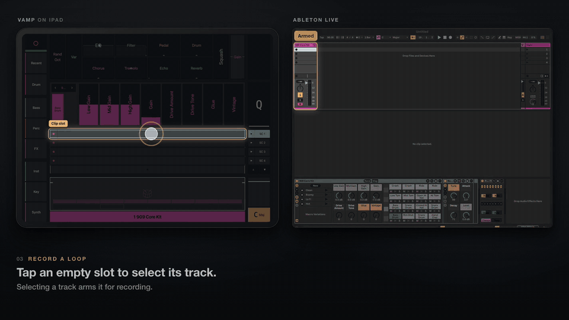
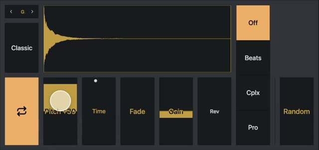
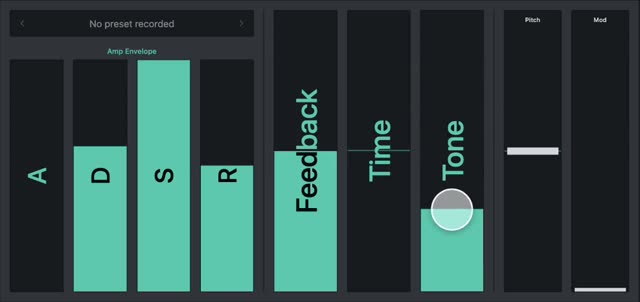
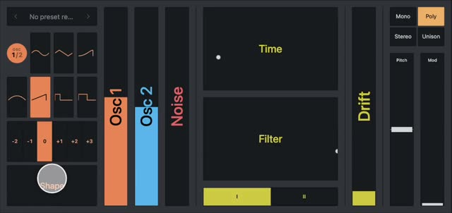
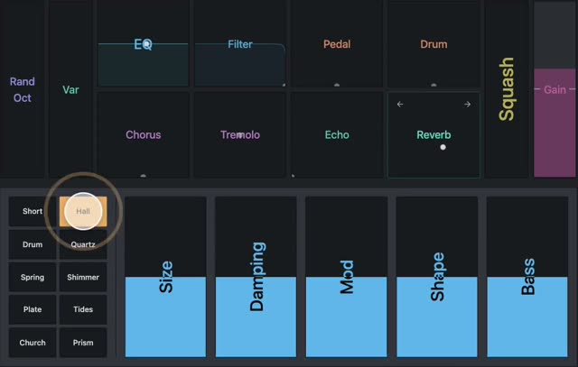

# Vamp

Live looping for Ableton Live, played from an iPad.

Vamp turns an iPad into a touch surface for performing with Live: record and launch loops, browse
and load instruments, shape sounds and effects, and sequence variations, without looking at the
laptop. It was built by a dance accompanist for playing ballet class and is shared as is.
More about it at [benjuodvalkis.com/other/vamp](https://benjuodvalkis.com/other/vamp).

**[Download Vamp for Mac](https://github.com/ben-juodvalkis/vamp/releases/latest/download/Vamp.dmg)**
(free, notarized by Apple, updates itself). It runs in the Mac's menu bar and serves Vamp to the
iPad: open it in Vamp for iPad over the USB-C cable, or in Safari over USB-C or Wi-Fi.



[](LICENSE)

> **Status: released.** It runs every day on its author's rig and is ready for yours. A few tiles
> still expect the author's files (see [Known gaps](#known-gaps)).

## What it does

- **Tracks and clips.** Every track as a strip with its clip slots: record, launch, stop and
  overdub loops, with volume, mute and solo by touch. The selected track arms itself (Auto-Arm,
  in Settings). Group tracks fold.
- **A browser over Live's own library.** The Places in Live's sidebar, your User Library and
  your Packs, read from Live's index. Pick which ones show in Settings. A load lands on an empty
  track or a new one, colored by what it holds.
- **Instrument views.** Controls laid out per instrument: Simpler, Drum Rack (kit-wide controls
  that keep each pad's own tuning), Sampler, Operator, Drift, Wavetable and more, plus a pad grid.
- **Permute,** a step sequencer for each track that mutes and transposes what is playing, 16
  steps per lane, run by the control surface in time with Live.
- **On-screen pitch and mod wheels** for any MIDI track.
- **Capture:** record what you just played and turn it into a Simpler instrument.
- **Key detection:** Live's key follows the loops you are playing.
- **A foot switch,** any MIDI footswitch, taught with Learn in Settings.

<p>
  
  
  
  
</p>

**[Watch the five-minute walkthrough and a clip of every feature →](https://benjuodvalkis.com/other/vamp)**

## Requirements

- **macOS 14** or later, Apple Silicon or Intel
- **Ableton Live 12.4 Suite** (Max for Live is included in Suite)
- An **iPad**: Vamp for iPad over USB-C, or Safari over USB-C or Wi-Fi. A Mac browser works too.

No third-party plug-ins and no special hardware are needed. Nothing else to install: Vamp for Mac
carries everything it runs.

## Quick start

1. **[Download Vamp.dmg](https://github.com/ben-juodvalkis/vamp/releases/latest/download/Vamp.dmg)**,
   drag **Vamp** to Applications and open it. It asks where to put the Vamp Devices folder and
   puts its control surface in Live.
2. In Live, **Settings → Link, Tempo & MIDI:** pick **Vamp** as a Control Surface, then quit and
   reopen Live.
3. Optional: in Live's browser, **Places → Add Folder…** and pick the Vamp Devices folder. That
   turns on Permute, the on-screen wheels and Capture.
4. On the iPad, open **Vamp for iPad** with the cable in and type the code the Mac's menu bar
   shows. Or scan the QR code in Vamp's menu to open it in Safari.

Vamp's menu-bar menu ticks each step off as it is done.
[INSTALLATION.md](INSTALLATION.md) has every step, and how to run Vamp from the code to work on it.

## How it fits together

```
iPad / browser  ⇄  bridge (WebSocket ⇄ OSC)  ⇄  control surface inside Live  ⇄  Live
  interface/        interface/bridge/                surface/
```

- **`interface/`**: the SvelteKit web app the iPad runs, and its server.
- **`interface/bridge/`**: the Node bridge between the page's WebSocket and the surface's OSC.
- **`surface/`**: a Python control surface Live loads as "Vamp". It does everything that touches
  Live.
- **`Vamp Devices/`**: the Max for Live utilities the app loads for you (Permute, the wheels,
  Random Start, the recorder, the groove). It is the one folder you add to Live's sidebar.
- **`owner/`**: parts of the author's own rig (a macOS accessibility helper, a menu-bar app, a
  Max patch for the Ableton Move, test probes). They are switched off unless
  `config/constants.local.json` turns them on; nothing here needs them.
- **`docs/`**: `reference/` (architecture, the wire protocol, the feature switches),
  `plans/` and `adr/` (the decision records).

## Known gaps

- **Vamp's own effects need the author's files.** The Guitar and Bass amp racks, the Wah, the
  Tone Shaper, Pitch Shift, GlitchLoop, Chance and the author's other Max effects are not in this
  repo. Each tile looks for its file by name in the effects folder you choose in Settings →
  Places (ADR-498); where it is not there, the tile says so and loads nothing. Every other
  effect inserts Live's own device, set up the way your Live defaults have it.
- **A device pairs once** before it can drive your Live set, with a code in Live's status bar or
  Allow on a screen already connected; the Mac never does, and Vamp for iPad on the cable pairs
  once with Vamp for Mac, with a code the Mac shows in its menu bar. The page is
  plain HTTP, so prefer the cable or a network you trust: see [SECURITY.md](SECURITY.md).

## Documentation

- [INSTALLATION.md](INSTALLATION.md): install, connect the iPad, troubleshoot
- [docs/reference/setup.md](docs/reference/setup.md): the details behind each setup step, and
  more troubleshooting
- [docs/reference/architecture.md](docs/reference/architecture.md): processes, ports and message
  flow
- [docs/reference/toggles.md](docs/reference/toggles.md): what each feature switch does
- [SECURITY.md](SECURITY.md): what your network can reach, playing safely, and reporting a
  vulnerability
- [CONTRIBUTING.md](CONTRIBUTING.md): working on the code

## License

MIT, © 2025–2026 Ben Juodvalkis. See [LICENSE](LICENSE) and
[THIRD-PARTY-NOTICES.md](THIRD-PARTY-NOTICES.md).
