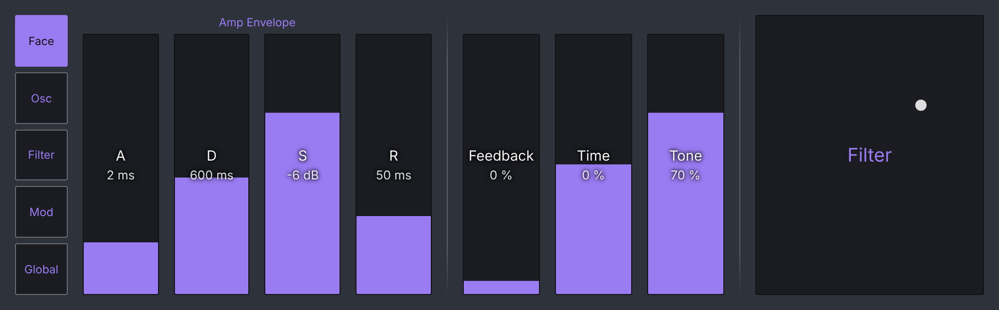
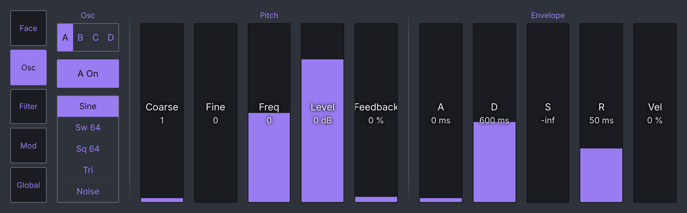
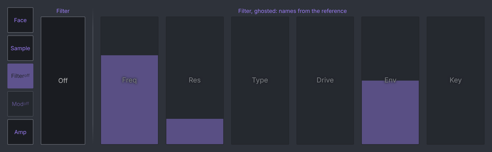

# Proposal: a UI system for device complexity

Status: proposal for Ben to choose from (2026-10-27). Nothing here is built.

The central view is about 1062 x 330 px on the 12.9-inch iPad and 850 x 236
on the mini. The instruments behind it have from 34 parameters (Electric)
to 195 (Operator), measured in `docs/reference/instruments/`. Each view
today is a hand-laid selection, and the selections are uneven:

| Instrument | Params | What its view reaches (about) | Share |
|---|---|---|---|
| Operator | 195 | Amp envelope, Feedback, Time, Tone, Filter freq/res | 10 (5%) |
| Analog | 172 | Per voice: shape, octave, Sub/Sync, Level, Noise, routing, Glide, filter, both envelopes, voice mode; two voices | ~44 (26%) |
| Collision | 140 | Resonator 1's XY | 2 (1%) |
| Meld | 129 | Per engine: osc type, Macro XY, filter, two envelopes, Drive, Spread | ~32 (25%) |
| Wavetable | 93 | Osc and filter tabs, two envelopes, mod | ~30 (32%) |
| Drift | 66 | Osc card, mixer, Time and Filter pads, voicing | ~20 (30%) |
| Simpler | 63 / 33 | Loop, mode, Pitch, Time, Fade, Gain, warp | ~12 |
| Sampler | 70 / 157 | Gain, Trnsp, Spread, Osc/Pitch pads, envelope, Filter | ~14 |
| Electric | 34 | Hammer and Fork XYs | 4 (12%) |

The dense views (Analog, Wavetable) are already past what the band holds:
Analog's voice card is 44px a row only since this branch's fix and ~30 on
the mini, while Collision and Electric leave most of their device out of
reach. One system should give each instrument the same shape: a few
controls always there, everything else one tap away, laid out by rule
rather than by hand.

## The system: a face and pages

**1. The face** is what the view shows on arrival: the controls a player
reaches for mid-set, at most about ten value boxes and one or two pads,
laid out as the views are now (tall boxes, seams between groups). Most
views' current layout becomes its face unchanged. The face is the only
hand-designed page.

**2. Pages** hold the rest, one per section of the device as Live itself
groups it (the parameter names already carry it: Operator's `Osc-A`,
`Ae`/`Fe`/`Pe`, `LFO`, `Filter`; Analog's `OSC1`, `F1`, `AEG1`, `LFO1`;
Collision's `Mallet`, `Noise`, `Res 1`, `Res 2`, `LFO`). A page is laid out
**by rule from data**, not by hand:

- a quantized parameter with a few labels (Live's own, from the
  reference) → a segmented chooser column;
- an on/off parameter that heads a section → that page's switch, first
  column;
- a bipolar range → a centre-origin value box; anything else → a value box;
- the boxes in one row on one ruler, as Chord's are, with a seam between
  sub-groups (Pitch | Envelope); about ten boxes fit at 1366 (≥ 85 px
  wide), eight on the mini. A section with more is two rows, never a third.

**3. The section rail**: a column down the view's left edge, at most
**five** chips (Face first). Five is the touch floor's limit: 298 px of
band over five chips is ~52 px a chip, and nine (one per Operator section)
would be 27. So sections with several instances share one chip and pick
the instance inside the page with the badge the views already use for
OSC 1/2 and FLT 1/2: Operator's rail is Face · Osc · Filter · Mod · Global,
and its Osc page carries an A B C D strip. The rail costs the band ~70 px of
width, the same the swap pill's column does today, and the swap pill moves
onto the face (most instrument views already host it there).

| Face | A page (Operator, Osc A) |
|---|---|
|  |  |

*Sketches, not the app: static HTML at the band's size
(`node docs/plans/device-complexity/sketches.mjs docs/plans/device-complexity`).*

### Sections whose parameters come and go

Simpler and Sampler drop a section's parameters while it is off and shift
every later index (reference README). The system meets that in three
rules:

- **The page list comes from the reference, not from the live list.** A
  section's page always exists; while its switch is off the rail chip says
  `off`, and the page shows the switch unlit and its boxes ghosted, named
  from the reference.
- **Every read and write resolves by name at the moment it happens**
  (`paramRange`, as the Sampler view already does), never by an index
  cached from an earlier list.
- **Touching a ghosted box turns its section on first**, then writes when
  the parameter appears (the Sampler row's existing "a section's switch
  written with its amount" rule, generalised).

A Multisample-Mode Simpler (`multi_sample_mode` true, `sample` none) gets
no Sample page at all: the profile is chosen from those attributes, not
from the class, so nothing draws a waveform it cannot read.

### One system from 34 to 195

| | Electric (34) | Collision (140) | Operator (195) |
|---|---|---|---|
| Face | Hammer, Fork, Damper, Pickup, Volume | Mallet, Res 1 Decay/Tune, Res 2 Mix, Volume | as today |
| Pages | Mallet · Fork · Damper/Pickup · Global (one row each) | Mallet · Noise · Res (1/2) · LFO (1/2) | Osc (A–D) · Filter · Mod (LFO, Pitch Env) · Global |
| Boxes a page | ≤ 8 | ≤ 20 (two rows on Res) | ≤ 20 |

A small device simply has fewer chips; Electric's whole device is two
taps from its face.

## How it fits the house rules

- **Value boxes (ADR-477), seams (ADR-433), spacing roles (ADR-434)**: a
  page is the same material as a face. The rule-laid page is a new layout,
  not a new control.
- **One control per device (ADR-479)**: `deviceControls.ts` keeps the one
  entry the chain cell and browser tile draw. The pages are a new, separate
  data module per instrument (say `instrumentPages.ts`): for each section,
  its name, its switch's parameter name and the parameter names in order,
  checked against the reference by a test. No index, range or conversion
  in a component: ranges and labels come from the live parameter, names
  from the module.
- **The reference is ground truth**: a test reads
  `docs/reference/instruments/dumps/*.json` and fails when a page names a
  parameter the device does not have.

## Open questions for Ben

1. Rail on the left (where the swap pill column is) or the right (nearer
   the FX chain)? Left keeps the pill's place; right keeps the face's
   left-to-right reading undisturbed.
2. Does the view remember the last page per track, or always arrive on the
   face? (Arriving on the face is the safe default mid-set.)
3. Are the racks and plug-ins (Komplete Kontrol, Omnisphere) in scope?
   Their parameters are macros or a plug-in's list, with no Live sections;
   a rule-laid "all parameters" page in eights would cover them.

## What I would build first

**The page renderer and rail on Electric**, then **Collision**.

- Electric is the smallest device (34 parameters, six sections) and its
  view reaches 4 of them: it proves the data module, the renderer, the
  rail and the reference test with little to lay out, and every page it
  gains is new reach.
- Collision next: 140 parameters and a view that reaches 2, so the system
  pays off most there, and its two resonators and two LFOs exercise the
  instance badge.
- Simpler and Sampler third, for the section-off rules, once the renderer
  is trusted; Operator and Analog last, where the face already exists and
  the pages only add.
